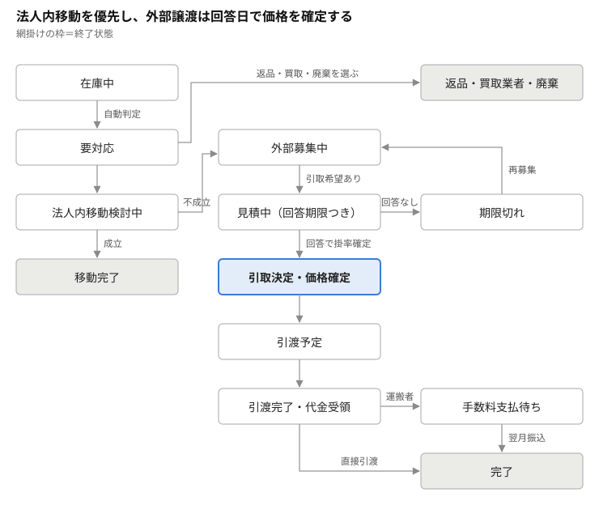

# 不動在庫・期限切迫・経過措置品 管理システム シート定義書

2026-10-08

## 概要

複数店舗の不動在庫・期限切迫品・経過措置品を一元管理し、法人内移動か外部譲渡かを判断して、取引完了まで追跡する。基盤はGoogleスプレッドシート＋GAS。

1. 各店舗の担当者が在庫データ（xlsx／CSV）を店舗別のDriveフォルダにアップロード
2. GASが定期実行で取り込み、列名を正規化して「在庫統合」へ反映
3. 不動・期限切迫・経過措置を自動判定し、ステータスを「要対応」に変更
4. 法人内移動を優先して検討。不成立なら外部募集（LINEグループ投稿文を自動生成）
5. 引取希望に対して見積を発行（回答期限付き）。回答日時点の掛率で価格確定
6. 引渡（直接 or 運搬代行業者）→ 代金受領 → 運搬手数料の翌月支払 → 完了
7. すべての操作を処理ログに記録し、譲渡記録として出力できるようにする

## シート一覧

| シート名 | 種別 | 役割 | 編集できる人 |
| --- | --- | --- | --- |
| 店舗マスタ | マスタ | 自社店舗の基本情報 | 管理者 |
| ユーザーマスタ | マスタ | Googleアカウントと店舗・権限の対応 | 管理者 |
| 医薬品マスタ | マスタ | 薬価・経過措置満了日・規制区分・保管条件 | 管理者（薬価改定時に更新） |
| 取引先マスタ | マスタ | 外部の譲受・譲渡先薬局 | 管理者 |
| 運搬者マスタ | マスタ | 運搬代行業者と手数料 | 管理者 |
| 設定 | マスタ | 判定閾値・掛率・回答期限日数など | 管理者 |
| 在庫統合 | トランザクション | 全店舗の対象在庫（1行＝1ロット） | GASのみ（担当者は状態列のみ） |
| 見積・取引 | トランザクション | 外部との見積から完了まで（1行＝1取引） | 担当者（自店舗分）・管理者 |
| 処理ログ | ログ | 全操作の履歴＝譲渡記録の元データ | GASのみ（追記専用） |
| 取込エラー | ログ | 取り込めなかった行と理由 | GASのみ |

パスワードはシートに持たない。本人確認はGoogleアカウントで行い、権限はユーザーマスタで管理する。

## マスタ系シートの列定義

### 店舗マスタ

| 列 | 型 | 例 | 備考 |
| --- | --- | --- | --- |
| 店舗ID | 文字列 | S001 | 主キー |
| 店舗名 | 文字列 | ○○薬局 |  |
| 開設者名 | 文字列 | 株式会社○○ | 譲渡記録に使用 |
| 住所 | 文字列 |  | 譲渡記録に使用 |
| 薬局許可番号 | 文字列 |  |  |
| 管理薬剤師 | 文字列 |  |  |
| アップロードフォルダID | 文字列 |  | 店舗別Driveフォルダ |
| 有効 | ✓ | TRUE | 閉店時はFALSE |

### ユーザーマスタ

| 列 | 型 | 例 | 備考 |
| --- | --- | --- | --- |
| ユーザーID | 文字列 | U001 | 主キー |
| メールアドレス | 文字列 |  | Googleアカウント。本人識別に使用 |
| 氏名 | 文字列 |  |  |
| 店舗ID | 文字列 | S001 | 管理者は空欄可 |
| 権限 | 選択 | 担当者／管理薬剤師／管理者／閲覧 |  |
| 有効 | ✓ | TRUE | 退職時はFALSE（削除しない） |

### 医薬品マスタ

| 列 | 型 | 例 | 備考 |
| --- | --- | --- | --- |
| 包装コード(GTIN) | 文字列 |  | 主キー。先頭0落ち防止で文字列 |
| YJコード | 文字列 |  |  |
| 品名・規格 | 文字列 |  |  |
| 包装単位 | 文字列 | 100錠 |  |
| 現在薬価 | 数値 |  | 1単位あたり・税込 |
| 薬価更新日 | 日付 |  |  |
| 経過措置満了日 | 日付 |  | 対象外は空欄 |
| 規制区分 | 選択 | なし／麻薬／覚醒剤原料／向精神薬1〜3種／毒薬／劇薬 | 外部譲渡の可否判定に使用 |
| 保管条件 | 選択 | 室温／冷所／遮光冷所 | 運搬時の警告に使用 |

### 取引先マスタ

| 列 | 型 | 例 | 備考 |
| --- | --- | --- | --- |
| 取引先ID | 文字列 | C001 | 主キー |
| 薬局名 | 文字列 |  |  |
| 開設者名（法人名） | 文字列 |  |  |
| 法人番号 | 文字列 |  | 初回取引時に確認 |
| 薬局許可番号 | 文字列 |  | 初回取引時に確認 |
| 住所 | 文字列 |  | 取引成立時までに入力必須 |
| 担当者・役職 | 文字列 | 代表／管理薬剤師 |  |
| 地域 | 選択 | ○○市○○区 など |  |
| 確認済み | ✓ |  | 許可番号等の確認完了 |

### 運搬者マスタ

| 列 | 型 | 例 | 備考 |
| --- | --- | --- | --- |
| 運搬者ID | 文字列 | T001 | 主キー |
| 名称 | 文字列 | 株式会社△△運輸 | 所有権を持たない運搬・代金授受の代行 |
| 住所・代表者 | 文字列 |  |  |
| 手数料 | 数値 |  | 金額確定後に入力 |
| 支払方法 | 文字列 | 翌月振込 |  |
| 冷所品対応 | ✓ |  | 未確認なら警告 |

### 設定

| キー | 初期値 | 意味 |
| --- | --- | --- |
| 不動判定日数 | 90 | 最終出庫からこの日数で不動 |
| 期限切迫月数 | 6 | 使用期限までこの月数で切迫 |
| 経過措置警告月数 | 3 | 満了日までこの月数で警告 |
| 通常掛率 | 0.7 | 期限まで3か月以上 |
| 期限間近掛率 | 0.5 | 期限まで3か月未満 |
| 掛率切替月数 | 3 |  |
| 見積回答期限日数 | 3 | 見積発行からの日数 |
| 端数処理 | 切り捨て | 未決（未決事項参照） |

## 在庫・取引系シートの列定義

### 在庫統合（1行＝1ロット）

| 列 | 型 | 入力元 | 備考 |
| --- | --- | --- | --- |
| 在庫管理ID | 文字列 | GAS採番 | 例 S001-20261008-0001 |
| 店舗ID | 文字列 | アップロード元フォルダ |  |
| 包装コード | 文字列 | 店舗データ | 医薬品マスタと照合 |
| 品名・規格 | 文字列 | マスタ参照 |  |
| ロット番号 | 文字列 | 店舗データ |  |
| 使用期限 | 日付 | 店舗データ |  |
| 数量 | 数値 | 店舗データ | 単位は包装単位に統一 |
| 包装状態 | 選択 | 店舗データ | 未開封／開封済み／端数 |
| 仕入値 | 数値 | 店舗データ | 1単位あたり・税込 |
| 現在薬価 | 数値 | マスタ参照 |  |
| 薬価金額 | 数値 | 計算 | 数量×現在薬価 |
| 仕入金額 | 数値 | 計算 | 数量×仕入値（損失見込み） |
| 最終出庫日 | 日付 | 店舗データ | 不動判定に使用 |
| 判定区分 | 複数 | GAS | 不動／期限切迫／経過措置 |
| 期限まで日数 | 数値 | 計算 |  |
| 今日時点の掛率 | 数値 | 計算 | 0.7／0.5 |
| 外部譲渡可否 | 選択 | GAS | 可／要確認／不可（規制区分による） |
| ステータス | 選択 | 担当者・GAS | ステータス定義参照 |
| 担当者 | 文字列 | GAS | 最終更新者のメール |
| 最終更新日時 | 日時 | GAS |  |
| 取込ファイル名 | 文字列 | GAS | トレース用 |
| 備考 | 文字列 | 担当者 |  |

同じ店舗・包装コード・ロットが再アップロードされた場合は数量を上書きし、行を増やさない。

### 見積・取引（1行＝1取引）

| 列 | 型 | 備考 |
| --- | --- | --- |
| 取引ID | 文字列 | GAS採番 |
| 在庫管理ID | 文字列 | 対象ロット |
| 区分 | 選択 | 法人内移動／外部譲渡 |
| 譲渡元店舗ID | 文字列 |  |
| 譲受先 | 文字列 | 店舗ID または 取引先ID |
| 先方担当者 | 文字列 |  |
| LINE投稿日 | 日付 | 外部のみ |
| 数量 | 数値 | 一部譲渡に対応 |
| 見積発行日 | 日付 |  |
| 回答期限 | 日付 | 発行日＋設定日数（自動） |
| 回答日 | 日付 | この日の残り期間で掛率確定 |
| 確定掛率 | 数値 | 回答日入力時に固定 |
| 確定単価 | 数値 | 薬価×確定掛率 |
| 取引金額（税込） | 数値 | 確定単価×数量 |
| 引渡方法 | 選択 | 直接／運搬者 |
| 運搬者ID | 文字列 |  |
| 引渡予定日・引渡日 | 日付 |  |
| 受領時数量確認 | ✓ | 譲受側で錠数確認済み |
| 代金受領日 | 日付 |  |
| 運搬手数料 | 数値 |  |
| 手数料支払予定月 | 年月 | 引渡月の翌月（自動） |
| 手数料支払日 | 日付 |  |
| ステータス | 選択 |  |

### 処理ログ（追記専用）

| 列 | 備考 |
| --- | --- |
| 日時 |  |
| 操作者メール | Session から取得 |
| 対象ID | 在庫管理ID または 取引ID |
| 操作 | 取込／ステータス変更／見積発行／価格確定 など |
| 変更前・変更後 |  |
| 譲渡記録項目 | 品名・数量・ロット・使用期限・譲渡日・相手先名称と住所 |

## ステータス定義と遷移ルール

要対応になった品は法人内移動を先に検討し、不成立のときだけ外部募集に進む。見積は回答期限を過ぎると外部募集中に戻る。

| ステータス | 変更する人 | 次に進む条件 |
| --- | --- | --- |
| 在庫中 | GAS | 判定条件に該当 |
| 要対応 | GAS | 担当者が対応方針を選ぶ |
| 法人内移動検討中 | 担当者 | 移動先店舗が決まる／不成立 |
| 移動完了 | 担当者 | 終了（移動先で在庫中として再登録） |
| 外部募集中 | 担当者 | LINE投稿日を入力 → 引取希望あり |
| 見積中 | 担当者 | 回答日入力／回答期限超過 |
| 期限切れ | GAS | 外部募集中へ戻す |
| 引取決定・価格確定 | GAS（回答日入力時） | 引渡予定日を入力 |
| 引渡予定 | 担当者 | 引渡日・受領時数量確認 |
| 引渡完了・代金受領 | 担当者 | 直接なら完了、運搬者なら手数料支払待ち |
| 手数料支払待ち | GAS | 手数料支払日を入力 |
| 完了 | GAS | 終了 |
| 返品・買取業者・廃棄 | 担当者 | 終了（理由と日付を必須入力） |

## 判定ロジック・価格計算・見積ルール

### 判定（取込時と毎朝の定期実行）

| 区分 | 条件 | 閾値の出所 |
| --- | --- | --- |
| 不動 | 今日 − 最終出庫日 ≥ 不動判定日数 | 設定 |
| 期限切迫 | 使用期限 − 今日 ≤ 期限切迫月数 | 設定 |
| 経過措置 | 経過措置満了日 − 今日 ≤ 経過措置警告月数 | 医薬品マスタ＋設定 |

複数該当は併記する。いずれかに該当した「在庫中」の行は「要対応」に変える。

### 価格

- 掛率：使用期限まで3か月以上 → 0.7、3か月未満 → 0.5
- 単価 = 現在薬価 × 掛率（薬価は税込のためそのまま税込価格）
- 一覧の「今日時点の掛率」は毎日再計算。取引の価格は回答日に固定し、以後は変えない
- 期限3か月到達の14日前から「◯日後に5掛けに変わります」と警告

### 見積

1. 引取希望を受けたら見積を発行。回答期限 = 発行日＋設定日数
2. 回答日を入力した時点で、その日の残り期間から掛率を確定し単価・金額を固定
3. 回答期限を過ぎても回答がなければ「期限切れ」とし、在庫側を「外部募集中」に戻す
4. 再見積は新しい取引IDで発行（旧見積は履歴として残す）

### LINE投稿文の自動生成

薬剤名・規格／使用期限／ロット／数量／参考単価（今日時点の掛率）を定型文にしてコピーできるようにする。規制区分が「不可」の品は生成しない。

## 規制区分・保管条件の制御

| 規制区分 | 外部譲渡可否 | システムの動き |
| --- | --- | --- |
| 麻薬 | 不可 | 外部募集・LINE投稿文生成をブロック |
| 覚醒剤原料 | 不可 | 同上 |
| 向精神薬 | 要確認 | 警告＋必要書類チェック欄を必須化 |
| 毒薬 | 要確認 | 警告＋譲受書の受領チェックを必須化 |
| 劇薬 | 要確認 | 警告＋譲受書の受領チェックを必須化 |
| なし | 可 | 通常どおり |

- 冷所・遮光冷所品で引渡方法に運搬者を選んだ場合、運搬者の冷所品対応が未確認なら警告する
- 運搬者は所有権を持たない。譲渡記録の相手先は常に薬局とし、運搬者は別欄に記録する
- 各区分の正確な要件は、所管の保健所または麻向法・薬機法施行規則で確認してから確定する

## 権限設計

| 操作 | 担当者 | 管理者 | 閲覧 |
| --- | --- | --- | --- |
| 自店舗データのアップロード | ○ | ○ | × |
| 自店舗在庫の閲覧 | ○ | ○ | ○ |
| 全店舗在庫の閲覧 | ×（他店の要対応品のみ） | ○ | ○ |
| ステータス変更（自店舗） | ○ | ○ | × |
| 見積発行・価格確定 | ○（自店舗分） | ○ | × |
| マスタ・設定の編集 | × | ○ | × |
| 処理ログの閲覧 | × | ○ | × |

- スプレッドシート本体は管理者のみ編集可。担当者はGASのWebアプリ（またはサイドバー）経由で操作する
- 操作者は `Session.getActiveUser()` で取得し、ユーザーマスタの権限と照合する
- 他店の要対応品を見せるのは、法人内移動の候補を探すため

## 訂正機能

原本は一切書き換えず、訂正はすべて追記で表現する。承認責任は各店舗の管理薬剤師（出庫誤りは出庫側の管理薬剤師）。

### 原則

- 取込原本：CSV／xlsxの各行をそのまま保存し編集禁止。ファイル自体もDriveの保管フォルダに残す
- 在庫統合は「原本＋有効な訂正」を日時順に適用した計算結果とし、いつでも再計算できる
- 取消は削除ではなく取消トランザクションを追記。再訂正は「取消＋新しい訂正」
- 任意の日時時点の在庫・取引状態を再現できる
- 複数項目の訂正は同じ訂正グループIDでまとめ、全件成功か全件失敗（LockServiceで排他 → 検証 → 追記 → 再計算）

### 取込原本

| 列 | 備考 |
| --- | --- |
| 取込バッチID | GAS採番 |
| 店舗ID・ファイル名・取込日時・取込者 |  |
| 行番号 | ファイル内の行 |
| 原本値 | 行全体をそのまま（JSON） |
| 在庫管理ID | 紐付く在庫行 |

### 在庫訂正トランザクション

| 列 | 備考 |
| --- | --- |
| 訂正ID・訂正グループID |  |
| 対象 | 取込バッチID＋行番号（＝在庫管理ID） |
| 項目・訂正前値・訂正後値 |  |
| 理由 | 選択式＋補足（入力ミス／レセコン出力誤り／実地棚卸差異 など） |
| 起票者・起票日時 |  |
| 承認者（管理薬剤師）・承認日時 | 承認まで在庫統合に反映しない |
| 取消元訂正ID | 取消の場合のみ |
| 関連取引訂正ID | 取引側と連動した場合 |
| 状態 | 承認待ち／有効／却下／取消済 |

### 取引訂正トランザクション（赤黒訂正）

元の取引行は残し、打ち消し（赤）と正しい内容（黒）を追記する。列構成は在庫訂正に準じ、対象を取引IDとする。

| 種別 | 例 | 動き |
| --- | --- | --- |
| 全部取消 | 実は在庫が無かった | 赤のみ |
| 数量訂正 | 10箱のはずが6箱 | 赤＋黒 |
| 金額訂正 | 掛率・単価の誤り | 赤＋黒 |
| 相手先訂正 | 記録した相手先の誤り | 赤＋黒 |

在庫が無いのに払い出した場合は、取引訂正と同時に出庫側の在庫訂正（実地棚卸差異）を自動起票して紐付ける。段階ごとの追加処理：

- 引渡前 → 相手先への連絡タスク
- 引渡後・代金受領済み → 返金予定を作成、運搬手数料の扱いを確認
- 法人内移動 → 移動元・移動先の両方を打ち消す
- 譲渡記録を出力済み → 元の記録は残し、訂正記録を追加出力

### ガード

- 価格確定後の取引に紐付く在庫のロット・期限・数量の訂正は、管理薬剤師承認＋取引側に警告
- 譲渡記録に出力済みの行の訂正も同様

## 出荷・伝票・検品・入出庫紐付け

出荷をまとめて送料を抑え、出庫伝票と入庫検品で突き合わせ、出庫明細と入庫在庫をIDで紐付ける。送料・返送料は原則として出庫側が負担する。

### 出荷バッチ

| 列 | 備考 |
| --- | --- |
| 出荷ID | GAS採番 |
| 出庫店舗ID・宛先 | 宛先は店舗ID または 取引先ID |
| 出荷予定日 |  |
| 方法 | 直接／運搬者／宅配 |
| 運搬者ID・送料 | 負担＝出庫側 |
| 保管条件区分 | 室温／冷所（混載不可） |
| 状態 | 準備中／出荷済み／検品完了 |

- 同じ宛先で出荷予定日が近い取引を「まとめ候補」として提示する
- 冷所品と室温品の同梱は警告する

### 出庫伝票（出庫側）

- 出荷バッチ単位で伝票番号を採番し、PDFを出力して同梱する
- 明細：明細ID、出庫側在庫管理ID、品名・規格、包装コード、ロット、期限、数量、単価、金額、取引ID

### 入庫検品（入庫側）

- 伝票番号を開くと明細が出て、行ごとに照合結果を選ぶ：一致／数量差／品違い／ロット違い／破損／未着
- 外部薬局はシステムを使わないため、先方からの連絡をもとに出庫側が結果を入力する

### 入出庫紐付けトランザクション

| 列 | 備考 |
| --- | --- |
| 照合ID |  |
| 出庫明細ID |  |
| 入庫側在庫管理ID | 一致時に新規採番（法人内のみ） |
| 照合結果・差異数量 |  |
| 実際に届いた品（包装コード・ロット・期限） | 品違い・ロット違いの場合 |
| 検品者・検品日時 |  |
| 取消元照合ID | 紐付け誤りの訂正用 |

一致した品は入庫側で新しい在庫管理IDの「在庫中」として登録し、由来として出庫明細IDを保持する。これでロット単位の店舗横断追跡と回収時の遡りができる。

### 差異の処理

| 結果 | 自動で起こすこと | 承認 |
| --- | --- | --- |
| 数量不足 | 取引訂正（数量）＋出庫側の在庫訂正 | 出庫側管理薬剤師 |
| 過剰・品違い | 返送用の出荷バッチを作成（送料は出庫側） | 出庫側管理薬剤師 |
| ロット違い | 紐付けを訂正し、両店舗の在庫を正しいロットへ | 両店舗の管理薬剤師 |
| 破損 | 取引訂正＋廃棄記録 | 出庫側管理薬剤師 |
| 未着 | 運搬者への照会タスク | なし |

## バーコード連携の入口（将来実装）

今回は実装しない。読み取り手段を後から差し込めるよう、受け口の仕様だけを決めておく。

- 受け口：GASのWebアプリ（doPost）に1本のエンドポイントを用意し、検品・取込画面の手入力も同じ処理を通す
- 入力：読み取った文字列そのもの＋用途（入庫検品／棚卸／出庫）＋伝票番号（検品時）＋操作者
- 解析：GS1のアプリケーション識別子で分解する（01＝GTIN、17＝有効期限、10＝ロット、21＝シリアル）
- 出力：包装コード・期限・ロットを返し、検品なら該当明細と自動照合した結果を返す
- 認証：Googleアカウント＋ユーザーマスタの権限で判定（APIキーを使う場合は管理者のみ発行）

手入力と読み取りで処理を共通化しておけば、後で読み取り手段（スマホカメラ、ハンディ端末など）を追加しても本体は変えずに済む。

## 未決事項

- [ ] 店舗数と、在庫データの出どころ（レセコン出力の列名サンプル）
- [ ] 不動判定日数・期限切迫月数の初期値（仮に90日・6か月）
- [ ] 端数処理：円未満の切り捨て／四捨五入、単価で丸めるか合計で丸めるか
- [ ] 見積の回答期限日数（仮に3日）
- [ ] 向精神薬・毒劇薬の外部譲渡に必要な書類と記録項目の確認
- [ ] 運搬手数料の金額と、冷所品の運搬可否（運搬者に確認）
- [ ] 担当者の操作画面：GAS Webアプリ か サイドバー か
- [ ] 修正済みデータを再アップロードしたとき、以前の在庫訂正を引き継ぐか破棄するか
- [ ] 返金時の記録項目（返金日・方法）と、取消時の運搬手数料の負担ルール
